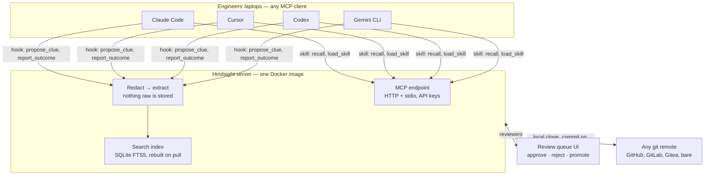

# Hindsight — Product Design

*Draft, 2 Nov 2026*

## Positioning

A self-hosted operational memory for your team's coding agents. Runbooks, service context, and what we learned last time — captured from agent sessions, reviewed like a postmortem, loaded over MCP into whatever agent you already use.

Name: **Hindsight** — it names the value (what we learned last time), not the mechanism, and works as a repo and a CLI (`hindsight recall`, `hindsight review`). Launch line: "Give your coding agent the on-call experience your team already paid for." The clue spec stays `CLUE.md`. MIT licence, no telemetry, any git remote.

## What it is and isn't

It is not an AI SRE agent. It is the knowledge layer underneath one. Every engineer keeps their own agent, workspace and model.

The server owns three things:

1. The team's SRE knowledge (services, runbooks, clues, skills).
2. The pipeline that captures that knowledge from agent sessions.
3. The review gate that turns a messy clue into a trusted fact.

Saying no to agent-runtime features is what keeps the project out of OpenSRE's lane.

## Content model

Typed SRE objects, not notes. Each is a markdown file with frontmatter in a git repo, and everything cross-links by service and alert name.

| Object | Path | Holds | Version |
| --- | --- | --- | --- |
| Service | `services/<name>.md` | Owner, repo, dashboards, alert names, runbook links, dependencies, known weirdness. The spine everything else hangs off. | v0.1 |
| Runbook | `runbooks/<alert-or-symptom>.md` | Step sequence written for an agent to execute and report on step by step, not prose for humans to skim. | v0.1 |
| Clue | `clues/<date>-<slug>.md` | One learned fact: what fired, what it was, what fixed it. Source session, author, confidence, status (proposed / approved / rejected / stale). A postmortem in miniature. | v0.1 |
| Skill | `skills/<name>/SKILL.md` | Standard skill folders; anything the ecosystem already produces drops in unchanged. | v0.1 |
| Incident | `incidents/<id>.md` | Groups clues; links to the Slack thread or ticket. | v0.2 |

This lets `recall` answer "what do we know about `payments-api` + `CrashLoopBackOff`?" with the runbook, the two approved clues from last quarter and the owner in one call. Publish the clue format as a spec (`CLUE.md`, like `SKILL.md`) so other tools can emit it.

## Architecture

One binary, one Docker image, `docker compose up` with a git remote URL as the only required config.

Agents retrieve over MCP and push clues through hooks; the server redacts, indexes and commits; reviewers work the queue; git is the only store.

- **Storage** — any git remote (GitHub, GitLab, Gitea, a bare repo). The server keeps a local clone, commits on write and pushes on a timer. No GitHub API dependency, works offline.
- **Search index** — SQLite FTS5 built from the clone on start and rebuilt on pull; optional embeddings behind a pluggable provider, off by default. This is what a plain git repo cannot do and the reason the server exists.
- **MCP tools** — `recall` (free text / service / alert), `get_runbook`, `list_skills` / `load_skill`, `propose_clue`, `report_outcome` ("ran runbook X, step 4 fixed it"). Streamable HTTP plus stdio for local use.
- **Auth** — API keys per user issued by the server, with `whoami`, so every commit carries a real author. Teams exist as a folder scope (`teams/<name>/...`) and a key→team mapping from day one; read scopes are enforced in v0.2 as config, not a rewrite.
- **Web UI** — one page that matters: the review queue. Everything else is "open it in git".

## Capture: hooks, not hope

The injected skill handles retrieval only ("before investigating, call `recall`"). Capture runs through agent hooks shipped per agent (Claude Code hooks, Cursor rules/hooks, Codex, Gemini CLI), so a clue is written even when the model forgets.

1. On session end, or on a `/clue` command, the hook sends a summarised transcript to `propose_clue`.
2. The server redacts it (next section), then runs an LLM pass with the user's own key — never a hosted one — to extract candidate clues tagged with service and alert.
3. Candidates land in the review queue as `proposed`.

Install is one command per agent, modelled on the `npx skills add` pattern so it feels familiar.

## Redaction before write

A launch blocker, so it ships in v0.1. Every inbound clue passes a redaction stage before it touches git; there is no raw store, ever.

- Regex rules for tokens, keys, IPs, emails and customer IDs; an optional allow-list of known hostnames; a configurable denylist.
- Redacted spans show as `[REDACTED:token]` in the review queue so a reviewer can see something was stripped.
- Documented prominently in the README and a security page. It is the first question a platform lead asks.

## Review: the product

Standardisation comes from the review step, not from storage. The queue is the product; the server is plumbing.

A proposed clue shows the extracted fact, the redacted session excerpt, the service it is tagged to, and a diff against any runbook it touches. Reviewer actions:

- **Approve** — commits the clue; an optional runbook edit lands as a separate commit.
- **Reject** — recorded, so the same clue is not re-proposed.
- **Promote to runbook** — turns a repeated clue into a step.

Approved clues rank high in `recall`; proposed ones are returned with a visible "unreviewed" flag so agents can use them but must say so. Clues older than N days with no `report_outcome` confirmation are auto-flagged `stale`. Because everything is a commit, teams that want full ceremony can require approvals as pull requests and use their normal code review.

## Install and requirements

One required setting, a git remote URL; everything else is optional and unlocks one feature each. No integrations, and no LLM key, are needed to retrieve, search or review.

| Setting | Required | Unlocks | Without it |
| --- | --- | --- | --- |
| `GIT_REMOTE` | Yes | Storage and versioning; the server clones it on first start | Server will not start |
| `GIT_AUTH` (SSH key or token) | Only for private remotes | Push and pull | Read-only against a public remote |
| `LLM_PROVIDER` + key or local endpoint | No | Automatic clue extraction from session transcripts in the capture step | Hooks post the redacted transcript as a raw proposed clue; the reviewer writes the clue by hand |
| `EMBEDDINGS_PROVIDER` | No | Semantic ranking in `recall` on top of FTS5 | Plain full-text search, which is enough for v0.1 |
| `REDACTION_RULES` | No (defaults ship) | Extra regexes, hostname allow-list, denylist | Built-in rules for tokens, keys, IPs, emails, customer IDs |
| Slack, PagerDuty, observability connectors | No | Nothing in v0.1 | Nothing lost; incidents linking is v0.2 |

What the server exposes:

- An MCP server over streamable HTTP, plus stdio for a laptop-local run.
- A small HTTP API behind it: key issuance, `whoami`, the review queue.
- The review-queue web UI on the same port.

Per-engineer setup is three steps: get an API key from the server (self-serve, or issued by whoever runs it), run the one-line installer for your agent (adds the MCP entry, the retrieval skill and the capture hook), ask the agent about a service. Every commit the server makes then carries that engineer's name.

## Cross-agent from day one

Claude Code, Cursor, Codex, Gemini CLI, plus a generic "any MCP client" path. If it only works with one agent, half the team cannot use it and the shared part evaporates. The skill and hook packages are per agent; the server does not care. CI runs the install and a `recall` smoke test against all four.

## Scope

| Version | In |
| --- | --- |
| v0.1 | Services, runbooks, clues, skills; the five MCP tools; hooks for two agents; redaction; review queue; any git remote; `docker compose up`; seeded sample repo |
| v0.2 | Team read scopes; incidents; outcome tracking and staleness; all four agents; embeddings |
| Never (say so in the README) | Running an agent; executing commands against prod; hosting your data; RBAC beyond team scoping; telemetry |

## How it differs from OpenSRE and team-memory tools

Two unrelated projects are called OpenSRE, and both *are the agent*; Hindsight is the memory the engineer's existing agent pulls from. The README line: "If you want an agent that gets paged, use OpenSRE. If you want your existing Claude Code or Cursor sessions to share what the team knows, use this. They are complementary — OpenSRE could be a client of this server."

| Project | What it is | Where it overlaps | Where Hindsight differs |
| --- | --- | --- | --- |
| [OpenSRE (Tracer Cloud)](https://github.com/Tracer-Cloud/opensre) | Apache-2.0 framework for building AI SRE agents that investigate incidents on your own infra; REPL in the style of Claude Code; RL environment and synthetic RCA benchmark | Has a guardrails system that redacts or blocks sensitive data in LLM calls, and a "local agent fleet" feature that monitors Claude Code, Cursor and Codex on your machine; collects anonymous usage stats via Posthog | Not an agent, no runtime, no telemetry; SRE-typed memory with a review gate rather than an investigation loop |
| [OpenSRE (opensre.in)](https://github.com/swapnildahiphale/OpenSRE) | Apache-2.0 self-hosted AI SRE agent with episodic memory, a Neo4j knowledge graph, web console, Slack and Teams bots | "Learns from every investigation" is the same instinct as clues | Memory lives in git as reviewable markdown, not in a graph DB owned by one agent; works with any coding agent |
| [Krimto](https://glama.ai/mcp/servers/rrnd4nuegn) | Apache-2.0 team memory for coding agents: markdown in git, user → team → org scopes, cross-vendor MCP; PR approval flow on the roadmap | Closest architecture: git-backed, MCP, cross-vendor | Generic notes vs typed services, runbooks, clues; redaction and SRE-shaped review are the gap |
| [Glen](https://composio.dev/toolkits/glen_mcp/framework/atomic-agent.md), [Bhived](https://github.com/artkeyai/bhived-mcp) | Hosted org memory and skills over MCP | Shared memory, skills, session import | Self-hosted only; knows what an alert, a runbook and a service are |
| [Hindsight (Vectorize)](https://github.com/vectorize-io/hindsight) | MIT agent memory server with banks, retain/recall/reflect, a coding-agents installer covering ~20 harnesses | Same name; same hook + MCP + skill install pattern | General-purpose memory for any agent; no SRE object model, no review gate, no git-as-store. Naming collision to address in the README. |

The one-line contrast against the memory tools: they store notes; Hindsight stores runbooks, services and incident learnings, and knows what an alert is.

## Adoption plan

The first-run demo must take two minutes: `docker compose up` → install the hook in Claude Code → ask the agent about a fake alert → it answers with a runbook and a clue from a seeded sample repo shipped in the image.

- [ ] Landing page leads with a screenshot of the review queue ("3 clues proposed from last night's on-call, 1 approved"), not an architecture diagram.
- [ ] One launch post, roughly "Your coding agent forgets every incident. Here's how we fixed that.", with a demo GIF, for r/sre, r/devops, Hacker News, SRE Weekly and the Kubernetes Slack.
- [ ] Publish `CLUE.md` as a spec so other tools can emit clues. Specs attract integrations; servers don't.
- [ ] MIT licence plus a plain "no telemetry, ever" line in the README, the opposite of Tracer's OpenSRE.
- [ ] Contributor on-ramps that match the audience: "add a hook for agent X" and "add a redaction rule" are each an afternoon of work and visibly useful.
- [ ] Decide and state early whether this is personal or an on-ramp to a commercial product; the Krimto "fully open source, no managed-service restriction" comparison is the stick people reach for otherwise.
