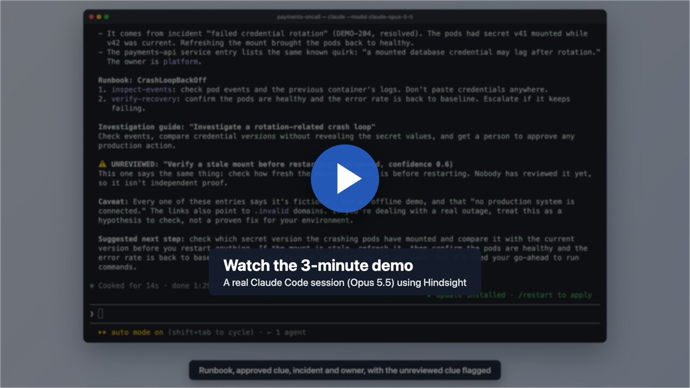
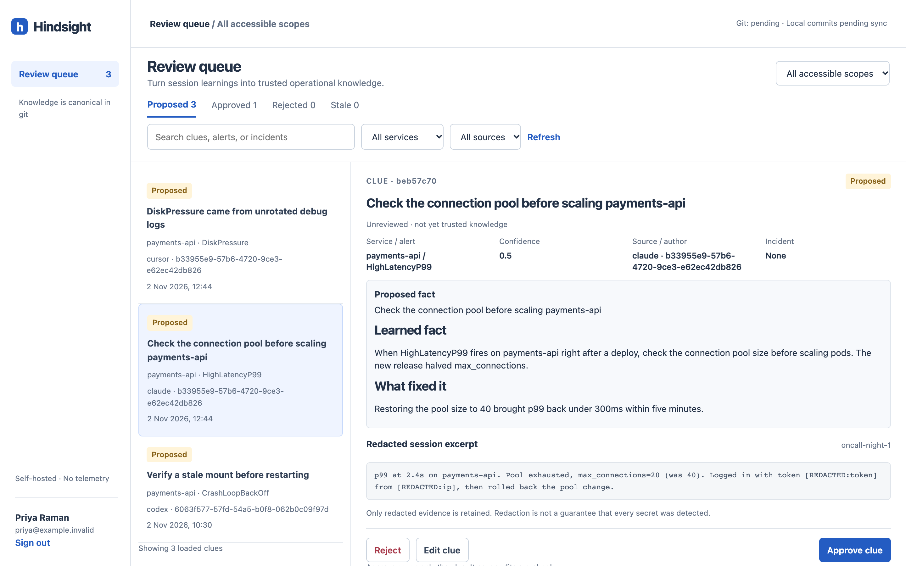

<p align="center">
  
</p>

<h1 align="center">Hindsight</h1>

<p align="center">
  <strong>Self-hosted operational memory for your team's coding agents.</strong><br>
  Runbooks, service context and reviewed incident learnings, stored in git and served over MCP to Claude Code, Cursor, Codex and Gemini CLI.
</p>

<p align="center">
  <a href="https://github.com/DrDroidLab/hindsight/actions/workflows/ci.yml"></a>
  <a href="LICENSE"></a>
  <a href="https://drdroidlab.github.io/hindsight/"></a>
  
</p>

<p align="center">
  <a href="https://drdroidlab.github.io/hindsight/">Documentation</a> ·
  <a href="https://drdroidlab.github.io/hindsight/getting-started/">Quickstart</a> ·
  <a href="https://drdroidlab.github.io/hindsight/how-it-works/">How it works</a> ·
  <a href="CLUE.md">CLUE.md spec</a> ·
  <a href="https://drdroidlab.github.io/hindsight/faq/">FAQ</a>
</p>

[](https://drdroidlab.github.io/hindsight/#demo)



## Why Hindsight

Your coding agent forgets every incident. The engineer who learned that `CrashLoopBackOff` on `payments-api` after a credential rotation means a stale secret mount took that lesson home; the next person's agent starts from zero.

Hindsight keeps that knowledge without becoming another agent you have to run:

- **Captures** learnings from agent sessions through lifecycle hooks, or explicitly through the CLI and MCP.
- **Redacts** tokens, keys, IPs, emails and customer IDs before anything is written. There is no raw transcript store.
- **Reviews** every learning in a queue. Proposed clues stay labelled *unreviewed* until a human approves them, and promoting a clue into a runbook is a separate, diffed commit.
- **Serves** approved runbooks, services and clues to whichever agent each engineer already uses, over MCP.

Everything is typed Markdown in a git remote you control, every commit carries the real engineer as author, and nothing leaves your infrastructure.

## Quickstart

Requires Docker with Compose v2 and git. The demo runs offline with a seeded sample repo, no model provider and no git credentials.

```sh
git clone https://github.com/DrDroidLab/hindsight.git
cd hindsight
docker compose -f compose.yaml -f compose.demo.yaml up --build -d
docker compose exec hindsight hindsight admin bootstrap
```

Open <http://localhost:8080/setup>, paste the enrollment token, save the API key shown once, and sign in. Then approve the proposed clue and promote it to the CrashLoopBackOff runbook. If port 8080 is busy, set `HINDSIGHT_PORT` before `up`.

### Connect your agent

```sh
python3.12 -m venv .venv && . .venv/bin/activate
pip install .
hindsight login --server http://localhost:8080 --scope shared
hindsight install claude --server http://localhost:8080   # or cursor, codex, gemini
```

Restart the agent and ask: *"Recall what we know about payments-api CrashLoopBackOff after credential rotation."* The full walkthrough, including deploying against your own git remote, is in the [quickstart guide](https://drdroidlab.github.io/hindsight/getting-started/).

## Features

| | |
| --- | --- |
| **Typed SRE knowledge** | Services, runbooks with stable step IDs, clues, skills, incidents and outcomes, cross-linked by service and alert ([content model](https://drdroidlab.github.io/hindsight/content-model/)) |
| **Seven MCP tools** | `recall`, `get_runbook`, `list_skills`, `load_skill`, `propose_clue`, `report_outcome`, `whoami` over Streamable HTTP or stdio ([API](https://drdroidlab.github.io/hindsight/api/)) |
| **Review queue** | Approve, reject, edit and promote to runbook, with revision conflict detection; or review as git pull requests with `REVIEW_MODE=git` |
| **Trust states** | Proposed, approved, stale and rejected clues are labelled in every recall; clues go stale without a confirming outcome |
| **Any git remote** | GitHub, GitLab, Gitea or a bare repo; local clone, commit on write, push on a timer, works offline |
| **Search** | SQLite FTS5 rebuilt from git; optional embeddings from your own endpoint |
| **Per-user keys and team scopes** | Every commit is attributed to a verified engineer; scopes filter results before counts and snippets |
| **No model required** | Capture, review and recall work without an LLM; optional extraction uses your own key or a local model |

## What Hindsight is not

Hindsight is not an AI SRE agent. It never gets paged, runs commands against production, or hosts your data, and it sends no telemetry. It is the knowledge layer underneath the agent each engineer already uses. If you want an agent that investigates incidents for you, see projects like OpenSRE; they are complementary, and such an agent could be a Hindsight client. See the [comparison](https://drdroidlab.github.io/hindsight/comparison/).

> This MIT-licensed project is published as **`hindsight-sre`** and is unrelated to the Vectorize project also named Hindsight.

## Security

Redaction runs in the agent hook and again on the server, but it is best effort: no detector finds every secret, so reviewers should read the evidence before approving. Start from a dedicated, sanitized knowledge remote, keep the server behind HTTPS, and back up the private auth state separately from git. Read the [security model](https://drdroidlab.github.io/hindsight/security/) and [operations guide](https://drdroidlab.github.io/hindsight/operations/), and report vulnerabilities privately as described in [SECURITY.md](SECURITY.md).

## Project status

Early-stage, v0.1. The automated suite (Python, frontend, and an offline Docker smoke test) passes in CI. Live agent clients and live LLM providers have not yet been certified; per-client hook support and limits are documented in [Connect your agent](https://drdroidlab.github.io/hindsight/agents/), and the [verification record](https://drdroidlab.github.io/hindsight/verification/) lists exactly what has and has not been checked.

## Development

```sh
pip install -e '.[dev]'
npm ci --prefix web && npm run build --prefix web
pytest && npm test --prefix web
ruff check src tests scripts && mypy src/hindsight
```

To work on the documentation site:

```sh
pip install -e '.[docs]'
mkdocs serve
```

See [CONTRIBUTING.md](CONTRIBUTING.md). Good first contributions: a capture hook for another agent, or a new redaction rule.

## License

[MIT](LICENSE)
