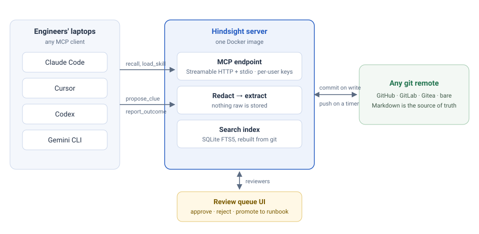
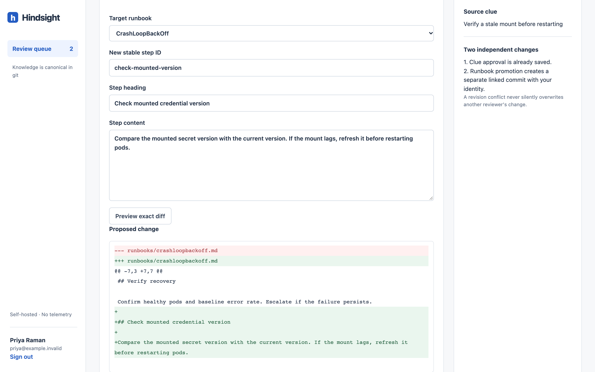

# How it works

Hindsight owns three things: the team's SRE knowledge, the pipeline that captures that knowledge from agent sessions, and the review gate that turns a messy clue into a trusted fact. It deliberately owns nothing else. There is no agent runtime, no production access and no hosted service.

{ .hs-diagram width="960" height="470" }

## The knowledge model

Knowledge is typed SRE objects, not free-form notes. Each object is a Markdown file with YAML frontmatter in a git repository, and everything cross-links by service and alert name.

| Object | Path | Holds |
| --- | --- | --- |
| Service | `services/<name>.md` | Owner, repository, dashboards, alert names, runbook links, dependencies, known quirks. The spine everything else hangs off. |
| Runbook | `runbooks/<alert-or-symptom>.md` | Steps with stable IDs, written for an agent to execute and report on step by step. |
| Clue | `clues/<date>-<slug>.md` | One learned fact: what fired, what it was, what fixed it, with source, author, confidence and status. A postmortem in miniature. |
| Skill | `skills/<name>/SKILL.md` | Standard skill folders; existing ecosystem skills drop in unchanged. |
| Incident | `incidents/<id>.md` | Groups clues and links to the Slack thread or ticket. |
| Outcome | `outcomes/<id>.md` | An explicit report that a runbook step succeeded, failed or partly worked. |

This is what lets a single `recall` for `payments-api` + `CrashLoopBackOff` return the runbook, the approved clues from last quarter and the owner. Prefix any path with `teams/<team>/` to scope it to a team. See the [content model](content-model.md) for full schemas and the [CLUE.md spec](clue-spec.md) for the clue format.

## Capture: hooks, not hope

The retrieval skill installed into each agent only says "before investigating, call `recall`". Capture runs through agent lifecycle hooks, so a clue can be written even when the model forgets.

1. On session end, or on a `/clue` command where the client supports one, the hook reads a bounded transcript, drops tool payloads and environment dumps, redacts locally, and sends a summary to `propose_clue`.
2. The server redacts again. If you configured an LLM endpoint, it extracts candidate clues tagged with service and alert using your own key or local model, never a hosted fallback.
3. Candidates are committed to git as `proposed` and appear in the review queue.

Without a model, the redacted summary becomes a draft clue and the reviewer writes the fact by hand. Capture is idempotent per `capture_id`, so a retried hook does not create duplicates.

## Redaction before write

Every inbound clue passes a redaction stage before it touches git, the index or a model provider. There is no raw store.

- Built-in rules cover tokens and API keys, private keys, URL credentials, password assignments, IP addresses, emails and customer IDs.
- Operators can add their own patterns and a hostname allow-list through `REDACTION_RULES`.
- Redacted spans show as `[REDACTED:token]`, `[REDACTED:ip]` and so on, so a reviewer can see that something was stripped.

Redaction is best effort. No detector finds every secret, so reviewers should read the evidence before approving. See the [security model](security.md).

## Review: the product

Standardisation comes from the review step, not from storage. A proposed clue shows the extracted fact, the redacted session excerpt, the service and alert it is tagged to, and the incident it belongs to.

- **Approve** records human trust in the fact as a git commit. It never edits a runbook.
- **Reject** is recorded with a reason, and the clue's fingerprint stops the identical fact being proposed again.
- **Edit** lets a reviewer rewrite the fact without any model.
- **Promote to runbook** turns an approved clue into a new runbook step, after previewing the exact diff. It is a separate commit linked to the clue.

{ .hs-shot width="1440" height="900" }

Teams that want full ceremony can set `REVIEW_MODE=git`: captures land on a proposal branch and are reviewed as normal pull requests with branch protection.

## Trust states in recall

| Status | Meaning | In `recall` |
| --- | --- | --- |
| `proposed` | Captured, not yet reviewed | Returned with an *unreviewed* flag; agents may use it but must say so |
| `approved` | A human reviewed the evidence | Ranked highest |
| `stale` | Approved, but no confirming outcome for N days (default 90) | Returned with a warning to re-check |
| `rejected` | Reviewed and declined | Excluded, kept for audit and duplicate suppression |

`report_outcome` lets an agent record "ran runbook X, step `check-mounted-version` fixed it". A reported success can renew a clue's confirmation, but it never approves a proposed clue on its own.

## Storage, search and auth

- **Git is the only store.** The server keeps a local clone, commits on every write and pushes on a timer. There is no GitHub API dependency, and local commits stay usable during an upstream outage.
- **Search** is SQLite FTS5, rebuilt from the clone on start and after each pull. Optional embeddings add semantic ranking.
- **Auth** uses per-user API keys issued by the server, so every commit carries a real author. Keys map to team scopes, and scopes are filtered before results, counts and snippets.
- **MCP** is served over Streamable HTTP at `/mcp`, plus stdio for local use and a stdio-to-HTTP proxy for clients that only speak stdio.

## What it never does

Hindsight does not run an agent, execute commands against production, host your data, offer RBAC beyond team scoping, or send telemetry.
