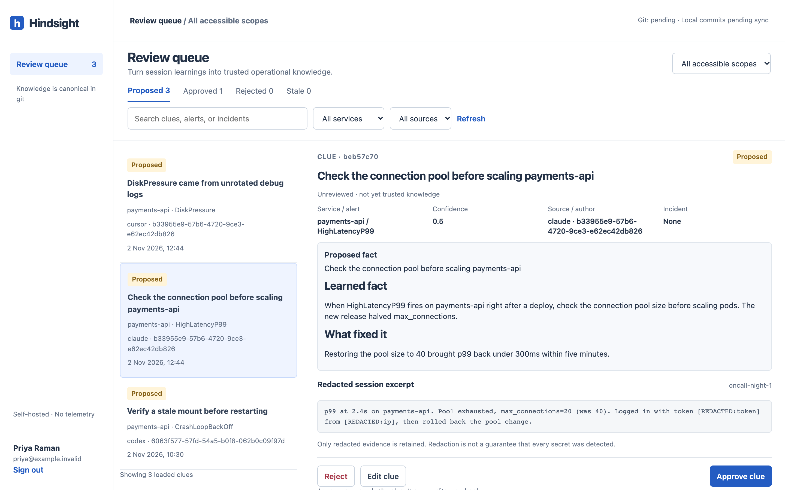
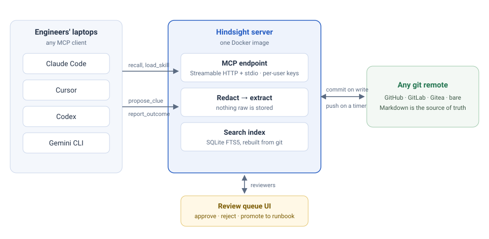

<div class="hs-hero" markdown>

# Your coding agent forgets every incident. Hindsight remembers.

<p class="hs-lede">A self-hosted, git-backed memory layer for your team's coding agents. Hindsight captures what an agent learned on call, redacts it, puts it through a human review queue, and serves the approved runbooks and clues back to Claude Code, Cursor, Codex and Gemini CLI over MCP.</p>

[Run the demo in 2 minutes](getting-started.md){ .md-button .md-button--primary }
[View on GitHub](https://github.com/DrDroidLab/hindsight){ .md-button }

</div>

<figure markdown>
{ .hs-shot width="1440" height="900" }
<figcaption class="hs-caption">The review queue: three clues proposed from last night's on-call. Secrets in the evidence were redacted before anything touched git.</figcaption>
</figure>

## See it in action { #demo }

<video controls preload="none" playsinline width="1280" height="720" poster="assets/video/demo-poster.jpg" class="hs-video">
  <source src="assets/video/hindsight-demo.mp4" type="video/mp4">
  <a href="assets/video/hindsight-demo.mp4">Download the 3-minute demo video</a>
</video>

A real Claude Code session running Opus 5.5 against a local Hindsight server: the agent recalls the team's runbook and an approved fix, saves a new fix with the secret redacted, a teammate approves and promotes it, and the next engineer's agent has it on the first question. Long model pauses are shortened.

## Give your coding agent the on-call experience your team already paid for

Every incident teaches someone something: which dashboard lies, which alert means the credential mount is stale, which step in the runbook actually fixed it. Today that knowledge dies in a chat transcript. Hindsight keeps it, without turning into another agent you have to run.

<div class="hs-grid" markdown>

<div class="hs-card" markdown>
### Typed SRE knowledge, not notes
Services, runbooks, clues, skills, incidents and outcomes. Each is a Markdown file with frontmatter, cross-linked by service and alert name.
</div>

<div class="hs-card" markdown>
### Review is the product
Proposed clues stay labelled *unreviewed* until a human approves them. Approving a clue never edits a runbook; promotion is a separate, diffed commit.
</div>

<div class="hs-card" markdown>
### Redaction before write
Tokens, keys, IPs, emails and customer IDs become `[REDACTED:type]` before anything is committed or indexed. There is no raw transcript store.
</div>

<div class="hs-card" markdown>
### Works with the agent you already use
One MCP server for Claude Code, Cursor, Codex, Gemini CLI or any MCP client. Lifecycle hooks capture learnings without relying on the model to remember; [support varies by client](agents.md).
</div>

<div class="hs-card" markdown>
### Git is the only store
Any git remote: GitHub, GitLab, Gitea or a bare repo. Every write is a commit with the real engineer as author. Works offline.
</div>

<div class="hs-card" markdown>
### No model required, no telemetry
Capture, review and full-text recall work with no LLM key. Optional extraction and embeddings use your own endpoint. MIT licensed.
</div>

</div>

## How it works

{ .hs-diagram width="960" height="470" }

1. **Recall.** Before investigating, the agent calls `recall` with a service, an alert or free text. One call returns the runbook, approved clues, open incidents and the owner, with unreviewed and stale results clearly labelled.
2. **Capture.** At session end, or on `/clue`, a hook sends a summarised, locally redacted transcript to `propose_clue`. The server redacts again and commits it as a *proposed* clue.
3. **Review.** A teammate inspects the evidence, edits the fact, then approves or rejects it. Repeated clues can be promoted into a runbook step after previewing the exact diff.
4. **Reuse.** The next engineer's agent, whichever one they use, gets the approved knowledge on its first `recall`.

[Read the full architecture](how-it-works.md){ .md-button }

## Try it locally

```sh
git clone https://github.com/DrDroidLab/hindsight.git
cd hindsight
docker compose -f compose.yaml -f compose.demo.yaml up --build -d
docker compose exec hindsight hindsight admin bootstrap
```

Open `http://localhost:8080/setup`, paste the enrollment token, and review the seeded sample clue. The demo needs no git credentials, no model provider and no network once the image is built. See the [quickstart](getting-started.md) for connecting your agent.

## What Hindsight is not

Hindsight is not an AI SRE agent. It does not get paged, run commands against production, or host your data. It is the knowledge layer underneath the agent each engineer already uses. If you want an agent that investigates incidents for you, look at projects like OpenSRE; Hindsight is complementary, and such an agent could be a client of it. [See how it compares](comparison.md).
